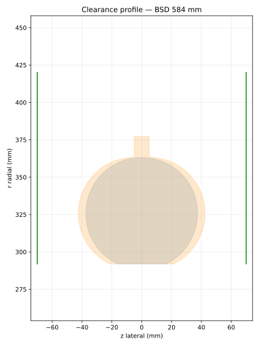

# Open Bicycle Clearance Specification (OBCS)

**Draft v0.1, community proposal, not affiliated with ETRTO/ISO.**

Bicycle clearance information is inconsistent: a single “max tyre” claim often
omits the rim diameter, actual tyre width, fenders, chainring setup, or required
safety margin. OBCS defines a common way to measure, publish, and check those
clearances. In American English, *tire* is the same component as a tyre; a
*mudguard* is a fender.

## One shape, two dimensions

Rotational symmetry reduces a complicated frame to a 2D radial/lateral profile.
The axle is the origin; `r` is radial distance and `z` is distance from the wheel
centre plane. The closest frame material on each side bounds the tyre.



## Publication levels

- **Level A (required):** a fit matrix by ETRTO bead-seat diameter (BSD) and
  measured tyre width, both without and with a fender. Each cell is the smallest
  gap in mm, `x` means no fit, and `null` means untested.
- **Level B (optional):** measured or calculated left/right clearance polylines,
  a radial limit, and a drive-side bottom-bracket profile.
- **Generated label:** the largest passing width for each BSD at a selected
  margin, plus chainring limits, fender mounts, conditions, and provenance.

BSDs use ISO 5775 / ETRTO bead-seat diameter and are never rounded. Sizes such
as 571/584/590 mm and 622/630/635 mm are distinct and close enough that rounding
can identify the wrong wheel.

### Example Level A matrix

Illustrative only; each value is the minimum measured gap in mm.

| BSD (mm) | Width (mm) | 35 | 40 | 45 | 50 |
|---:|---|---:|---:|---:|---:|
| 622 | no fender | 8 | 7 | 5 | 2 |
| 622 | fender | 6 | 4 | x | x |

At the default all-road margin of 6 mm, the first row passes through 40 mm.

### Example generated label

```text
FICTIONAL CYCLE / Example Endurance / 2026 / M
622 (700c): 35 mm without fender; 32 mm with fender — all-road (6 mm)
Chainrings: 2x, 50/34T; fender mounts: dropout_f, dropout_r, crown_hole
Conditions: illustrative reference geometry; provenance: fictional example
```

## Quick start

Python 3.11 or newer; install with `uv sync`. Run:

```sh
uv run obcs validate examples/*.yaml
uv run obcs check-tyre examples/gravel.yaml --bsd 622 --width 48 --margin all-road
uv run obcs label examples/gravel.yaml --format md
uv run obcs export-csv examples/gravel.yaml -o matrix.csv
uv run obcs import-csv examples/gravel.yaml matrix.csv -o updated.yaml
uv run pytest
```

The package also provides profile predictions, consistency checks, SVG plots,
printable matrix sheets, and Level A CSV import/export. See [SPEC.md](SPEC.md),
the [measurement guide](docs/measurement-guide.md), and the fictional
[examples](examples/).

## License

This work, including the specification, documentation, schema, examples, code,
and hardware designs, is dedicated to the public domain under CC0 1.0 Universal.
Anyone may use it for any purpose without attribution.
